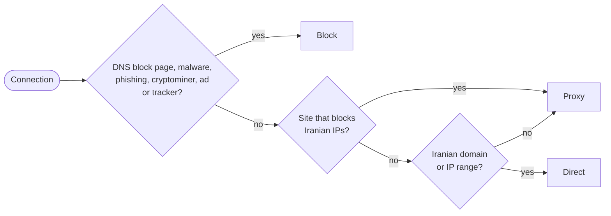

---
hide:
  - navigation
  - toc
---

<div class="vr-hero" markdown>

# Routing Rules

Routing rules and ready-made configs for proxy and VPN clients, rebuilt daily from public lists. Domestic
sites and IP ranges go direct (currently for **Iran**), sites that block domestic IPs go through the proxy,
and ads, trackers, malware, phishing and cryptominers are blocked: in sing-box, Clash/mihomo, Xray,
Shadowrocket, Karing, WireGuard, OpenVPN, browsers and DNS filters.

[:material-rocket-launch-outline: Get started](#pick-your-client){ .md-button .md-button--primary }
[:material-magnify: Check a domain](check.md){ .md-button }
[:material-download: Latest release](https://github.com/split-route/routing-rules/releases/latest){ .md-button }

</div>

## What the rules do



<div class="grid cards" markdown>

-   :material-shield-check-outline:{ .lg .middle } **Block**

    ---

    Ads and trackers (including Iranian ad networks), malware, phishing and cryptominers.

-   :material-earth:{ .lg .middle } **Proxy**

    ---

    Sites that refuse Iranian IPs, and everything not listed as Iranian.

-   :material-home-outline:{ .lg .middle } **Direct**

    ---

    Iranian sites and IP ranges, so domestic services stay fast and don't see a foreign IP.

-   :material-update:{ .lg .middle } **Updated daily**

    ---

    Rebuilt from upstream lists and validated with sing-box, Xray and mihomo. Each release lists what changed.

</div>

## Pick your client

### Apps

Ready-made configs in the app's own format.

<div class="grid cards" markdown>

-   :material-rocket-launch-outline:{ .lg .middle } **Shadowrocket**

    ---

    :material-apple: iOS. Import one URL.

    [:octicons-arrow-right-24: Guide](shadowrocket.md)

-   :material-waves:{ .lg .middle } **Surge & Loon**

    ---

    :material-apple: iOS. Paste rule lines into your config.

    [:octicons-arrow-right-24: Guide](surge-loon.md)

-   :material-vector-polyline:{ .lg .middle } **Karing**

    ---

    :material-apple: :material-android: :material-microsoft-windows: :material-linux: Import a rules file.

    [:octicons-arrow-right-24: Guide](karing.md)

-   :material-alpha-v-circle-outline:{ .lg .middle } **v2rayN / v2rayNG**

    ---

    :material-microsoft-windows: :material-android: Geo files plus a routing file.

    [:octicons-arrow-right-24: Guide](v2rayn.md)

</div>

### Cores

For your own config, or apps that load rule-sets or geo files.

<div class="grid cards" markdown>

-   :material-cube-outline:{ .lg .middle } **sing-box**

    ---

    Also SFI, SFA, Hiddify, NekoBox and other sing-box apps.

    [:octicons-arrow-right-24: Guide](sing-box.md)

-   :material-cat:{ .lg .middle } **Clash / mihomo**

    ---

    Also Clash Verge Rev, FlClash, Clash Meta for Android.

    [:octicons-arrow-right-24: Guide](clash.md)

-   :material-alpha-x-circle-outline:{ .lg .middle } **v2ray / Xray**

    ---

    `geosite.dat` and `geoip.dat` for Xray-based clients.

    [:octicons-arrow-right-24: Guide](v2ray.md)

</div>

### More

<div class="grid cards" markdown>

-   :material-router-network:{ .lg .middle } **WireGuard, OpenVPN & routers**

    ---

    Split-tunnel `AllowedIPs` and OpenVPN routes, MikroTik address lists, ipset and nftables.

    [:octicons-arrow-right-24: Guide](networks.md)

-   :material-call-split:{ .lg .middle } **macOS & Linux (splitroute)**

    ---

    A command-line tool that keeps Iranian IPs outside your VPN, next to any VPN app.

    [:octicons-arrow-right-24: Guide](splitroute.md)

-   :material-web:{ .lg .middle } **Browsers (PAC)**

    ---

    Iranian sites direct, everything else through your local proxy.

    [:octicons-arrow-right-24: Guide](pac.md)

-   :material-shield-search:{ .lg .middle } **AdGuard Home & Pi-hole**

    ---

    The block lists as DNS blocklists.

    [:octicons-arrow-right-24: Guide](dns-filters.md)

-   :material-magnify:{ .lg .middle } **Check a domain**

    ---

    See whether a domain or IP is blocked, direct or proxied.

    [:octicons-arrow-right-24: Open](check.md)

</div>

Every file and its URL: [File URLs](urls.md). Where the data comes from: [Sources and licenses](sources.md).

## Where the files are hosted

Every file is published as an asset of the latest [GitHub release](https://github.com/split-route/routing-rules/releases/latest),
rebuilt whenever an upstream list changes:

```
https://github.com/split-route/routing-rules/releases/latest/download/<file>
```

This URL always points to the newest version. It redirects to GitHub's download servers
(`release-assets.githubusercontent.com` / `objects.githubusercontent.com`), which may be filtered on some
networks in Iran. Apps follow the redirect automatically.

!!! warning "Avoid untrusted GitHub proxy sites"
    They can change the files, and these files decide what goes through your proxy or VPN and what goes direct.

## Optional lists

Published with everything else but not used by the default configs. Add them to your own rules if you want
them.

| List | Contents |
|------|----------|
| `social` | Social media domains |
| `nsfw` | Adult content |
| `tracking` | Device and OS telemetry: Apple, Samsung, Xiaomi, Huawei, Vivo, Amazon, LG, Roku, Windows/Office, TikTok. Can break some vendor features. |
| `ads-lite` | ~5k-rule alternative to `ads` (Iranian ad networks and trackers, Peter Lowe, v2fly) for memory-limited devices |
| `arvancloud`, `parspack`, `derak` | Iranian CDN IP ranges, including their servers abroad (Iranian ranges are already in `ir-cidr`) |
| `cloudflare`, `cloudfront`, `fastly`, `gcore` | CDN IP ranges |
| `telegram`, `tor-exit`, `netflix` | Service IP ranges (`tor-exit` is the `tor` tag in geo files and rule-sets) |

See [File URLs](urls.md) for every format.
