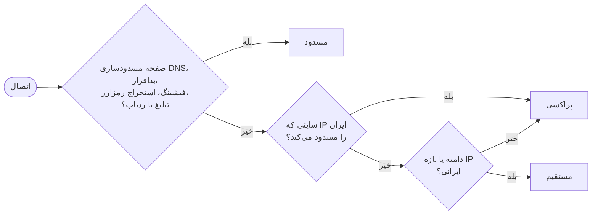

---
hide:
  - navigation
  - toc
---

<div class="vr-hero" markdown>

# قوانین مسیریابی

قوانین مسیریابی و کانفیگ‌های آماده برای کلاینت‌های پراکسی و VPN که هر روز از لیست‌های عمومی ساخته
می‌شوند. سایت‌ها و بازه‌های IP داخلی (فعلاً برای **ایران**) مستقیم وصل می‌شوند، سایت‌هایی که IP داخلی را
مسدود می‌کنند از پراکسی عبور می‌کنند، و تبلیغات، ردیاب‌ها، بدافزار، فیشینگ و استخراج‌کننده‌های رمزارز
مسدود می‌شوند: در sing-box، Clash/mihomo، Xray، Shadowrocket، Karing، WireGuard، OpenVPN، مرورگرها و
فیلترهای DNS.

[:material-rocket-launch-outline: شروع کنید](#pick-your-client){ .md-button .md-button--primary }
[:material-magnify: بررسی دامنه](check.md){ .md-button }
[:material-download: آخرین نسخه](https://github.com/split-route/routing-rules/releases/latest){ .md-button }

</div>

## قوانین چه می‌کنند



<div class="grid cards" markdown>

-   :material-shield-check-outline:{ .lg .middle } **مسدود**

    ---

    تبلیغات و ردیاب‌ها (از جمله شبکه‌های تبلیغاتی ایرانی)، بدافزار، فیشینگ و استخراج‌کننده‌های رمزارز.

-   :material-earth:{ .lg .middle } **پراکسی**

    ---

    سایت‌هایی که IP ایران را نمی‌پذیرند، و هر چیزی که در لیست سایت‌های ایرانی نیست.

-   :material-home-outline:{ .lg .middle } **مستقیم**

    ---

    سایت‌ها و بازه‌های IP ایران، تا سرویس‌های داخلی سریع بمانند و IP خارجی نبینند.

-   :material-update:{ .lg .middle } **آپدیت روزانه**

    ---

    از لیست‌های منبع ساخته و با sing-box، Xray و mihomo بررسی می‌شود. لیست تغییرات هر نسخه همراهش منتشر می‌شود.

</div>

## کلاینت خود را انتخاب کنید { #pick-your-client }

### برنامه‌ها

کانفیگ آماده در قالب خود برنامه.

<div class="grid cards" markdown>

-   :material-rocket-launch-outline:{ .lg .middle } **Shadowrocket**

    ---

    :material-apple: iOS. ایمپورت یک لینک.

    [:octicons-arrow-left-24: راهنما](shadowrocket.md)

-   :material-waves:{ .lg .middle } **Surge و Loon**

    ---

    :material-apple: iOS. افزودن خطوط قانون به کانفیگ.

    [:octicons-arrow-left-24: راهنما](surge-loon.md)

-   :material-vector-polyline:{ .lg .middle } **Karing**

    ---

    :material-apple: :material-android: :material-microsoft-windows: :material-linux: ایمپورت فایل قوانین.

    [:octicons-arrow-left-24: راهنما](karing.md)

-   :material-alpha-v-circle-outline:{ .lg .middle } **v2rayN / v2rayNG**

    ---

    :material-microsoft-windows: :material-android: فایل‌های geo به‌همراه فایل مسیریابی.

    [:octicons-arrow-left-24: راهنما](v2rayn.md)

</div>

### هسته‌ها

برای کانفیگ دستی، یا برنامه‌هایی که rule-set یا فایل geo دانلود می‌کنند.

<div class="grid cards" markdown>

-   :material-cube-outline:{ .lg .middle } **sing-box**

    ---

    همچنین SFI، SFA، Hiddify، NekoBox و دیگر برنامه‌های مبتنی بر sing-box.

    [:octicons-arrow-left-24: راهنما](sing-box.md)

-   :material-cat:{ .lg .middle } **Clash / mihomo**

    ---

    همچنین Clash Verge Rev، FlClash و Clash Meta for Android.

    [:octicons-arrow-left-24: راهنما](clash.md)

-   :material-alpha-x-circle-outline:{ .lg .middle } **v2ray / Xray**

    ---

    `geosite.dat` و `geoip.dat` برای کلاینت‌های مبتنی بر Xray.

    [:octicons-arrow-left-24: راهنما](v2ray.md)

</div>

### بیشتر

<div class="grid cards" markdown>

-   :material-router-network:{ .lg .middle } **WireGuard، OpenVPN و روترها**

    ---

    `AllowedIPs` برای تونل جداشده، مسیرهای OpenVPN، لیست آدرس MikroTik، ipset و nftables.

    [:octicons-arrow-left-24: راهنما](networks.md)

-   :material-call-split:{ .lg .middle } **macOS و Linux (splitroute)**

    ---

    ابزار خط فرمانی که IPهای ایران را کنار هر برنامه VPN، بیرون از VPN نگه می‌دارد.

    [:octicons-arrow-left-24: راهنما](splitroute.md)

-   :material-web:{ .lg .middle } **مرورگرها (PAC)**

    ---

    سایت‌های ایرانی مستقیم، بقیه از طریق پراکسی محلی.

    [:octicons-arrow-left-24: راهنما](pac.md)

-   :material-shield-search:{ .lg .middle } **AdGuard Home و Pi-hole**

    ---

    لیست‌های مسدودسازی به شکل لیست مسدودسازی DNS.

    [:octicons-arrow-left-24: راهنما](dns-filters.md)

-   :material-magnify:{ .lg .middle } **بررسی دامنه**

    ---

    ببینید یک دامنه یا IP مسدود، مستقیم یا از طریق پراکسی است.

    [:octicons-arrow-left-24: باز کردن](check.md)

</div>

همه فایل‌ها و لینک‌هایشان: [لینک فایل‌ها](urls.md). منبع داده‌ها: [منابع و مجوزها](sources.md) (به انگلیسی).

## فایل‌ها کجا منتشر می‌شوند

هر فایل به‌عنوان بخشی از [آخرین نسخه گیت‌هاب](https://github.com/split-route/routing-rules/releases/latest)
منتشر می‌شود و هر بار که یکی از لیست‌های منبع تغییر کند دوباره ساخته می‌شود:

```
https://github.com/split-route/routing-rules/releases/latest/download/<file>
```

این لینک همیشه به جدیدترین نسخه اشاره می‌کند. گیت‌هاب آن را به سرورهای دانلود خود
(`release-assets.githubusercontent.com` / `objects.githubusercontent.com`) هدایت می‌کند که ممکن است در
برخی شبکه‌های ایران فیلتر باشند. برنامه‌ها این هدایت را خودکار دنبال می‌کنند.

!!! warning "از سایت‌های پراکسی گیت‌هاب ناشناس استفاده نکنید"
    آن‌ها می‌توانند فایل‌ها را تغییر دهند، و این فایل‌ها تعیین می‌کنند چه چیزی از پراکسی یا VPN عبور کند و چه
    چیزی مستقیم برود.

## لیست‌های اختیاری

همراه بقیه منتشر می‌شوند اما کانفیگ‌های پیش‌فرض از آن‌ها استفاده نمی‌کنند. در صورت نیاز آن‌ها را به
قوانین خود اضافه کنید.

| لیست | محتوا |
|-------|-------|
| `social` | دامنه‌های شبکه‌های اجتماعی |
| `nsfw` | محتوای بزرگسالان |
| `tracking` | تله‌متری دستگاه و سیستم‌عامل: Apple، Samsung، Xiaomi، Huawei، Vivo، Amazon، LG، Roku، Windows/Office، TikTok. ممکن است برخی قابلیت‌های سازنده را از کار بیندازد. |
| `ads-lite` | جایگزین حدود ۵ هزار قانونی برای `ads` (شبکه‌های تبلیغاتی و ردیاب‌های ایرانی، Peter Lowe، v2fly) برای دستگاه‌هایی با حافظه کم |
| `arvancloud`، `parspack`، `derak` | بازه‌های IP شبکه‌های CDN ایرانی، همراه با سرورهای خارج از کشور (بازه‌های ایرانی در `ir-cidr` هستند) |
| `cloudflare`، `cloudfront`، `fastly`، `gcore` | بازه‌های IP شبکه‌های CDN |
| `telegram`، `tor-exit`، `netflix` | بازه‌های IP سرویس‌ها (`tor-exit` در فایل‌های geo و rule-setها برچسب `tor` دارد) |

همه قالب‌ها در [لینک فایل‌ها](urls.md).
